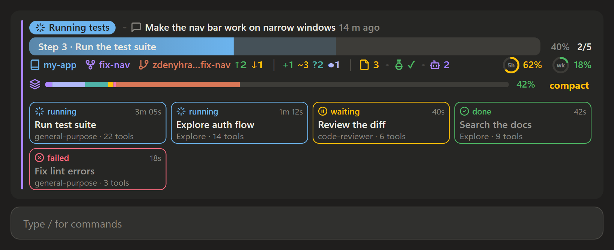
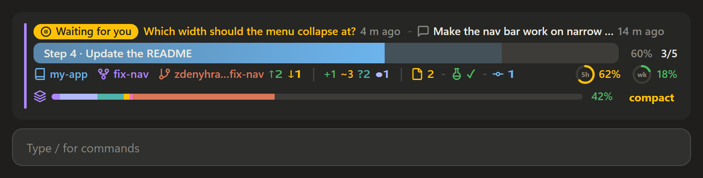
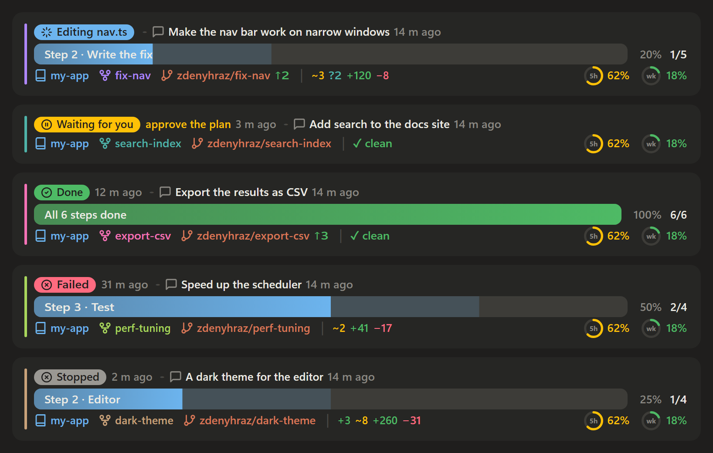
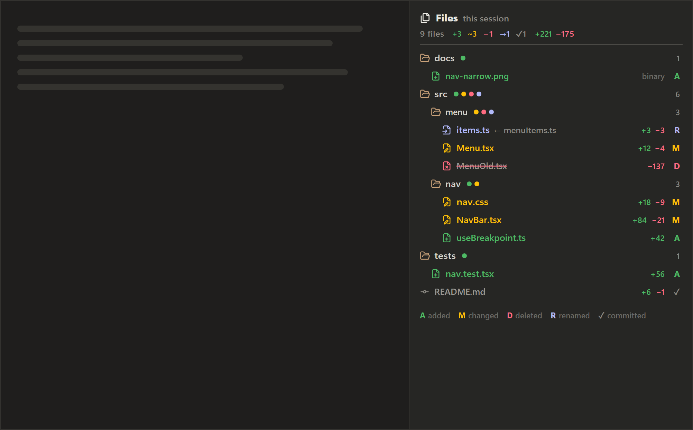
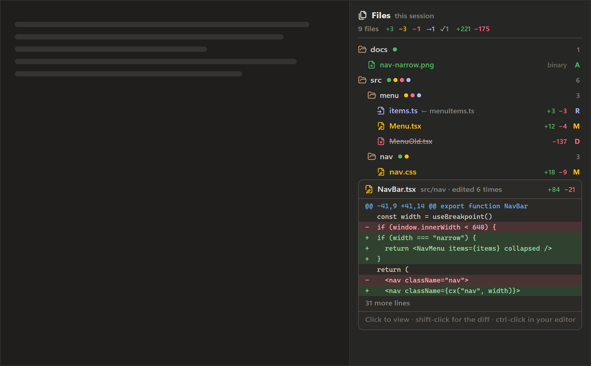

# claude-mods

Mods for [Claude Code](https://code.claude.com): plugins built on its function hooks that change its
interface. They are made for the Claude desktop app's Code tab and also work in the terminal.
Mods need Claude Code 2.1.287 or later.

| Mod | What it does |
| --- | --- |
| [git-band](plugins/git-band) | A session dashboard above the prompt: what the session is doing and your latest prompt, what changed since it, git branch, worktree and changes, context usage, plan limits and subagents. |
| [session-files](plugins/session-files) | A pane beside the transcript with the files this session added, changed, deleted, renamed or committed, as a tree coloured by change, with each file's diff on hover and the file with its changes marked on click. |

## git-band

While the session works, with subagents running:



Waiting for you:



Five sessions, each in a worktree with a colour of its own:



Drawn by the mod's own code with sample data, in the desktop app's dark theme.

## session-files



Hovering a file shows the start of its diff:



Clicking a file shows it under the tree, its added lines on green and removed ones on red; shift-click opens the
app's diff and ctrl-click your editor.

Drawn by the mod's own code with sample data, in the desktop app's dark theme.

## Install

At the prompt of a Claude Code terminal session:

```text
/plugin install git-band --marketplace zdenyhraz/claude-mods
```

Answer `y` to add the marketplace, then pick a scope (user is first). From a shell:

```sh
claude plugin install git-band --marketplace zdenyhraz/claude-mods
```

In the desktop app, where `/plugin` does not run: click **+** next to the prompt box, then **Plugins**,
**Add marketplace** with `zdenyhraz/claude-mods`, then **Add plugin**.

A mod installed at the user scope loads in every new session, the desktop app's included.

## Develop

Each mod lives in `plugins/<name>/` and is listed in `.claude-plugin/marketplace.json`.

```sh
claude plugin validate plugins/git-band
claude plugin test plugins/git-band
claude --plugin-dir plugins/git-band
```

## License

[MIT](LICENSE)
