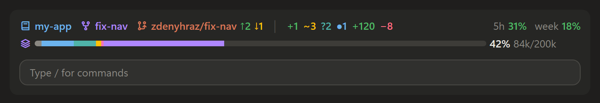

# claude-mods

Mods for [Claude Code](https://code.claude.com): plugins built on its function hooks that change its
interface. They are made for the Claude desktop app's Code tab and also work in the terminal.
Mods need Claude Code 2.1.287 or later.

| Mod | What it does |
| --- | --- |
| [git-band](plugins/git-band) | A session dashboard above the prompt: what the session is doing and for, what changed since your prompt, git branch, worktree and changes, context usage, plan limits and subagents. |

## git-band

While subagents run:


With none:



Drawn by the mod's own code with sample data, in the desktop app's dark theme.

## Install

At the prompt of a Claude Code terminal session:

```text
/plugin install git-band --marketplace zdenyhraz/claude-mods
```

Answer `y` to add the marketplace, then pick a scope (user is first). From a shell:

```sh
claude plugin install git-band --marketplace zdenyhraz/claude-mods
```

In the desktop app, where `/plugin` does not run: click **+** next to the prompt box, then **Plugins**,
**Add marketplace** with `zdenyhraz/claude-mods`, then **Add plugin**.

A mod installed at the user scope loads in every new session, the desktop app's included.

## Develop

Each mod lives in `plugins/<name>/` and is listed in `.claude-plugin/marketplace.json`.

```sh
claude plugin validate plugins/git-band
claude plugin test plugins/git-band
claude --plugin-dir plugins/git-band
```

## License

[MIT](LICENSE)
