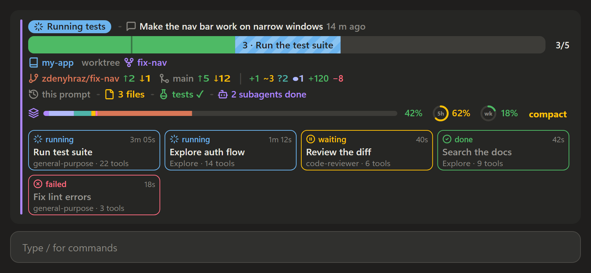
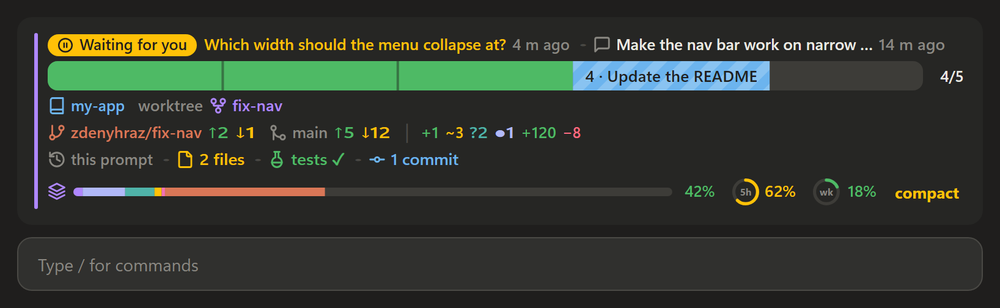
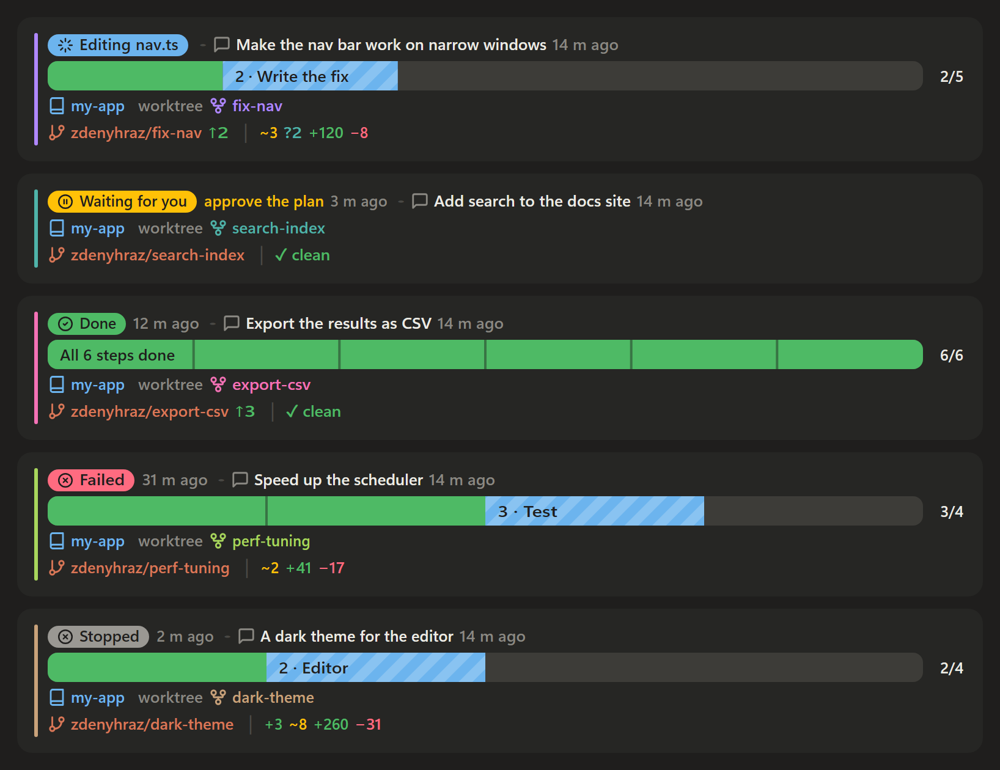

# claude-mods

Mods for [Claude Code](https://code.claude.com): plugins built on its function hooks that change its
interface. They are made for the Claude desktop app's Code tab and also work in the terminal.
Mods need Claude Code 2.1.287 or later.

| Mod | What it does |
| --- | --- |
| [glance](plugins/glance) | A session dashboard above the prompt: what the session is doing and your latest prompt, what changed since it, git branch, worktree and changes, context usage, plan limits and subagents. |

It also keeps my personal guidance for Claude, [user/CLAUDE.md](user/CLAUDE.md), so that every machine
I work on has the same.

## Set up a machine

```sh
git clone git@github.com:zdenyhraz/claude-mods.git
python claude-mods/setup.py
```

`setup.py` makes `~/.claude/CLAUDE.md` import `user/CLAUDE.md`, so the guidance applies in every
session, worktrees included. It also adds the clone as the `claude-mods` marketplace and installs its
mods at user scope, then warns if git has no global `user.name` or `user.email`. Where `claude` is
not on `PATH`, as with the desktop app alone, pass `--claude <path to claude>`. Running it again is safe.

To update, `git pull` in the clone: new sessions read the new guidance, and `/reload-plugins` loads the
new mods into a running one.

## glance

While the session works, with subagents running:



Waiting for you:



Five sessions, each in a worktree with a colour of its own:



Drawn by the mod's own code with sample data, in the desktop app's dark theme.

## Install

At the prompt of a Claude Code terminal session:

```text
/plugin install glance --marketplace zdenyhraz/claude-mods
```

Answer `y` to add the marketplace, then pick a scope (user is first). From a shell:

```sh
claude plugin install glance --marketplace zdenyhraz/claude-mods
```

In the desktop app, where `/plugin` does not run: click **+** next to the prompt box, then **Plugins**,
**Add marketplace** with `zdenyhraz/claude-mods`, then **Add plugin**.

A mod installed at the user scope loads in every new session, the desktop app's included.

## Develop

Each mod lives in `plugins/<name>/` and is listed in `.claude-plugin/marketplace.json`.

```sh
claude plugin validate plugins/glance
claude plugin test plugins/glance
claude --plugin-dir plugins/glance
```

## License

[MIT](LICENSE)
